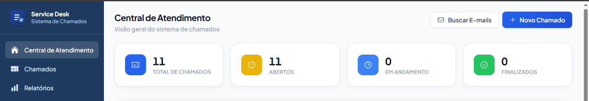

# 🖥️ Service Desk

Sistema completo de **Service Desk / helpdesk** para abertura, triagem e acompanhamento de chamados de TI, construído com **NestJS**, **React** e **Oracle Database**.

O sistema foi desenvolvido para uso interno em uma empresa de tecnologia, cobrindo o fluxo completo de atendimento: abertura manual ou automática (via e-mail), atribuição de responsáveis, priorização, anexos, relatórios gerenciais e rotina de backup.

> ⚠️ **Sobre este repositório:** este é o código-fonte da aplicação, disponibilizado como amostra de portfólio. Dados de produção, credenciais, backups e anexos de clientes foram removidos — veja [Segurança e dados sensíveis](#-segurança-e-dados-sensíveis) abaixo.

---

## 📸 Screenshot



*Dashboard com visão geral de chamados. A tabela de chamados recentes foi ocultada nesta captura por conter dados de clientes.*

---

## ✨ Principais funcionalidades

- **Autenticação JWT** com controle de papéis (admin / supervisor / técnico)
- **Abertura automática de chamados via e-mail** — integração com Gmail IMAP, com deduplicação por `Message-ID` e parsing em stream para lidar com anexos grandes sem travar o processo
- **Regras de auto-atribuição** de chamados configuráveis, com módulo de backend e frontend dedicados
- **Anexos** — upload/download de arquivos vinculados a cada chamado
- **Relatórios gerenciais** exportáveis em Excel
- **Backup agendado** (cron) dos dados da aplicação
- **Rate limiting** (throttling) para proteção contra abuso da API
- **Dashboard** com atualização silenciosa (polling) sem recarregar a página

## 🧱 Stack técnica

| Camada       | Tecnologias |
|--------------|-------------|
| **Backend**  | NestJS 10, TypeScript, `oracledb` (driver oficial Oracle), Passport + JWT, class-validator, ExcelJS, node-imap + mailparser |
| **Frontend** | React 18, Vite, TypeScript, TailwindCSS, Zustand, Axios |
| **Banco**    | Oracle Database (testado em Oracle XE 21c e Oracle Cloud Autonomous Database) |
| **Infra**    | Docker (ambiente local), migração documentada para VM dedicada |

## 📁 Estrutura do projeto

```
servicedesk/
├── backend/                  # API NestJS
│   ├── src/
│   │   ├── auth/             # Autenticação JWT (login, guards, strategies)
│   │   ├── tickets/          # CRUD e regras de negócio dos chamados
│   │   ├── ticket-types/     # Tipos de chamado configuráveis
│   │   ├── users/            # Gestão de usuários e papéis
│   │   ├── email/            # Integração Gmail IMAP (abertura automática de chamados)
│   │   ├── attachments/      # Upload/download de anexos
│   │   ├── auto-assign/      # Regras de atribuição automática
│   │   ├── reports/          # Relatórios em Excel
│   │   ├── backup/           # Rotina agendada de backup
│   │   ├── common/           # Guards, filtros de exceção, decorators
│   │   └── config/           # Configuração da aplicação e do pool Oracle
│   ├── scripts/               # Scripts utilitários de operação (hash de senha, inventário de objetos)
│   └── .env.example
├── frontend/                  # SPA React + TailwindCSS
│   └── src/
│       ├── pages/              # Login, Dashboard, Chamados, Relatórios, Usuários...
│       ├── components/         # Componentes reutilizáveis
│       ├── services/           # Cliente HTTP (Axios)
│       └── store/               # Estado global (Zustand)
└── database/
    ├── schema.sql                              # Schema Oracle completo (DDL)
    └── Migracao_Oracle_Docker_para_VirtualBox.pdf  # Runbook de migração Docker → VM dedicada
```

## 🚀 Como executar localmente

### Pré-requisitos
- Node.js 20+
- Uma instância Oracle acessível (XE local, Docker ou Oracle Cloud Autonomous Database)

### 1. Banco de dados
Execute o script de schema no seu Oracle:
```bash
sqlplus usuario/senha@sua_conexao @database/schema.sql
```

### 2. Backend
```bash
cd backend
npm install
cp .env.example .env   # preencha com suas credenciais — nunca versione o .env
npm run start:dev
```

### 3. Frontend
```bash
cd frontend
npm install
npm run dev
```

A aplicação sobe por padrão em `http://localhost:5173` (frontend) e `http://localhost:3000` (API).

## 🔐 Segurança e dados sensíveis

Este repositório foi preparado especificamente para publicação pública. Antes de subir, os seguintes itens foram **removidos ou sanitizados**:

- Arquivo `.env` real (credenciais de Oracle, senha de app do Gmail, JWT secret) — só o `.env.example` com placeholders permanece
- Backups e anexos reais de chamados de clientes
- Logs de depuração que imprimiam e-mail/senha em texto puro durante o login
- Scripts utilitários que continham senha de banco hardcoded — reescritos para ler credenciais de variáveis de ambiente
- Instalação de uma ferramenta de terceiros (PL/SQL Developer) que estava versionada por engano

Se você for reutilizar este projeto, **gere um `JWT_SECRET` novo**, use um usuário Oracle com privilégio mínimo necessário (não `SYSTEM`) e nunca commite o arquivo `.env`.

## 📄 Licença

Distribuído sob a licença MIT. Veja [LICENSE](LICENSE).

---

Desenvolvido por **Marcos Sousa** — Desenvolvedor Full Stack / DBA Oracle.
